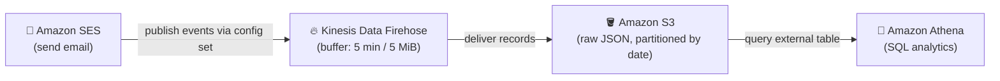

# Amazon SES Email Analytics Pipeline


A serverless data pipeline on AWS that captures **Amazon SES** email sending events (sends, deliveries, opens, clicks, bounces, complaints) in near real time, streams them through **Amazon Kinesis Data Firehose** into **Amazon S3**, and makes them queryable with **Amazon Athena**.

This lets you build dashboards and run SQL analytics on your email engagement and deliverability without managing any servers.

## Architecture



1. An SES **configuration set** is assigned to a verified identity (domain or email).
2. SES publishes selected **event types** to a Kinesis Data Firehose delivery stream.
3. Firehose buffers records and writes newline-delimited JSON to an **S3** bucket (partitioned by date).
4. **Athena** reads the S3 data via an external table so you can query it with standard SQL.

## Event types captured

| Category            | Events                                             |
| ------------------- | -------------------------------------------------- |
| Sending & delivery  | Send, Delivery, Reject, Rendering failure          |
| Deliverability      | Hard bounce, Complaint, Delivery delay             |
| Engagement          | Open, Click                                        |
| Subscription        | Subscription                                       |

## Repository layout

```
.
├── README.md
├── LICENSE
├── .gitignore
├── docs/
│   └── setup-guide.md                  # Step-by-step console walkthrough
├── cloudformation/                     # Infrastructure as Code (recommended)
│   └── ses-analytics-pipeline.yaml
└── athena/
    ├── create_table.sql                # External table over the S3 event data
    └── sample_queries.sql              # Example analytics queries
```

## Quick start

### Option 1 — CloudFormation (recommended)

```bash
aws cloudformation deploy \
  --template-file cloudformation/ses-analytics-pipeline.yaml \
  --stack-name ses-analytics-pipeline \
  --capabilities CAPABILITY_NAMED_IAM \
  --parameter-overrides BucketName=my-ses-analytics-bucket \
                        StreamName=aws-ses-analytics-firehose
```

Then assign the created configuration set to your verified SES identity (see
[`docs/setup-guide.md`](docs/setup-guide.md)).

> `CAPABILITY_NAMED_IAM` is required because the template creates named IAM roles.

### Option 2 — AWS Console

Follow the walkthrough in [`docs/setup-guide.md`](docs/setup-guide.md).

### Query the data in Athena

1. Run [`athena/create_table.sql`](athena/create_table.sql) once to create the table.
2. Explore with [`athena/sample_queries.sql`](athena/sample_queries.sql).

## Notes

- Firehose delivers to S3 every **5 minutes** or every **5 MiB**, whichever comes first.
- All names, account IDs, and ARNs in this repo are **placeholders** — replace them with your own.

## Reference

Based on the AWS Messaging & Targeting blog:
[Analyzing Amazon SES event data with AWS Analytics Services](https://aws.amazon.com/blogs/messaging-and-targeting/analyzing-amazon-ses-event-data-with-aws-analytics-services/)
